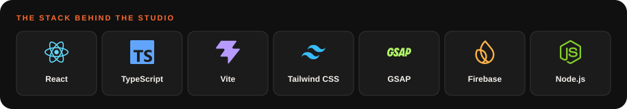
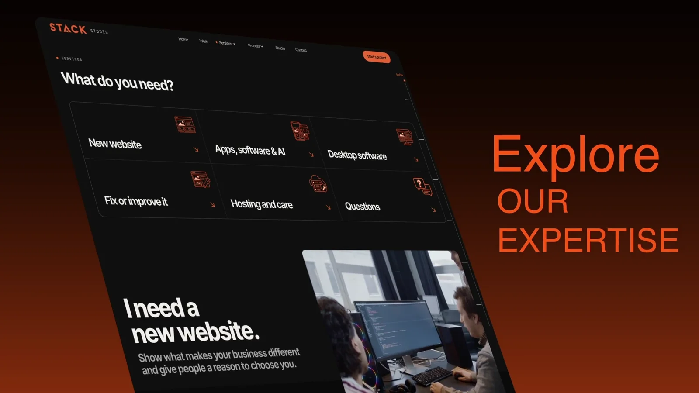

<a id="top"></a>

<div align="center">

  <a href="https://stack-studio.web.app/">
    
  </a>

  <h1>Stack Studio</h1>
  <p><strong>Build it. Run it. Grow it.</strong></p>
  <p>Websites, apps, software and AI systems for businesses ready to move forward.<br />Designed and built in Centurion, South Africa. 🇿🇦</p>

  <p>
    <a href="https://stack-studio.web.app/"><strong>🌐 Live website</strong></a>
    &nbsp;·&nbsp;
    <a href="https://stack-studio.web.app/work"><strong>↗ Explore our work</strong></a>
    &nbsp;·&nbsp;
    <a href="https://stack-studio.web.app/start"><strong>🚀 Start a project</strong></a>
  </p>

  <a href="#tech-stack">
    
  </a>

  <p><strong>Design with intent. Motion with purpose. A clear next step.</strong></p>

</div>

<p align="center">
  <a href="#overview">Overview</a> ·
  <a href="#showcase">Showcase</a> ·
  <a href="#selected-work">Selected work</a> ·
  <a href="#tech-stack">Tech stack</a> ·
  <a href="#quick-start">Quick start</a> ·
  <a href="#documentation">Documentation</a> ·
  <a href="#deployment">Deployment</a>
</p>

---

<a id="overview"></a>

## ✨ A studio website built to turn interest into a conversation

Stack Studio is the digital home of a two-person studio founded by **Enzo De Vittorio** and
**Armand Naudé**. It brings the studio's services, process, people and client work together in
one responsive experience, then helps visitors explain what they need through a guided project brief.

The design pairs bold typography, warm orange accents, dark surfaces and detailed device mockups.
The visitor journey stays simple: **find → understand → trust → contact**.

|                                | What makes it work                                                                                                        |
| ------------------------------ | ------------------------------------------------------------------------------------------------------------------------- |
| 🎬 **Purposeful motion**       | GSAP transitions, scroll-led storytelling and smooth scrolling with Lenis.                                                |
| 📱 **Responsive layouts**      | Desktop showcases and mobile layouts built around the same content and actions.                                           |
| 🧭 **Guided project briefs**   | Five enquiry paths, step-by-step validation, a tailored estimate or recommendation, and drafts saved for the current tab. |
| 📄 **A useful project record** | A submission reference, a shareable brief record and a downloadable PDF of the answers and recommendation.                |
| 📬 **Connected delivery**      | Firestore storage, EmailJS notifications and linked client replies, plus an optional JSON endpoint.                       |
| ♿ **Accessible interactions** | Reduced-motion support, keyboard focus states, a skip link and semantic page structure.                                   |
| ⚡ **Considered loading**      | Lazy-loaded secondary routes, deferred sections and responsive local media.                                               |

### 🗺️ Explore the site

| Page                                                     | What you will find                                                                |
| -------------------------------------------------------- | --------------------------------------------------------------------------------- |
| [🏠 Home](https://stack-studio.web.app/)                 | The studio at a glance: services, featured work and an invitation to get started. |
| [💼 Work](https://stack-studio.web.app/work)             | Client projects and individual case studies.                                      |
| [🛠️ Services](https://stack-studio.web.app/services)     | Websites, apps, software, AI systems, hosting and ongoing care.                   |
| [🧩 Process](https://stack-studio.web.app/process)       | How projects move from the first conversation to launch and support.              |
| [👋 Studio](https://stack-studio.web.app/studio)         | The founders, their principles and the tools behind the work.                     |
| [🚀 Start a project](https://stack-studio.web.app/start) | A guided brief that turns an idea into a clearer scope and recommendation.        |
| [✉️ Contact](https://stack-studio.web.app/contact)       | A direct route for general enquiries.                                             |

<a id="showcase"></a>

## 🖼️ See it in action

These mockups use screenshots captured from the running Stack Studio site. Select an image to
open it at full size.

### 🖥️ Desktop experience

<a href="docs/readme/desktop-home.webp"></a>

<details>
<summary><strong>👀 Explore the Work and Services screens</strong></summary>

<br />

<a href="docs/readme/desktop-work.webp"></a>

<a href="docs/readme/desktop-services.webp"></a>

</details>

### 📱 Mobile experience

<p align="center">
  <a href="docs/readme/mobile-home.webp"></a>
  <a href="docs/readme/mobile-brief.webp"></a>
</p>

### 🎥 The 32-second studio introduction

<div align="center">
  <a href="https://drive.google.com/file/d/1y_sKVunUR1TJbQ-wuSLVPSI5on-fRKaN/view?usp=sharing">
    
  </a>
  <p><a href="https://drive.google.com/file/d/1y_sKVunUR1TJbQ-wuSLVPSI5on-fRKaN/view?usp=sharing"><strong>▶ Watch the promo with sound</strong></a></p>
  <p>Opens in Google Drive. Press play and enable sound in the player.</p>
</div>

<a id="selected-work"></a>

## 💼 Selected work

| Project               | What we built                                                  | Explore                                                               |
| --------------------- | -------------------------------------------------------------- | --------------------------------------------------------------------- |
| ☀️ **GC Solar**       | An immersive redesign for a Gauteng solar installer.           | [View case study ↗](https://stack-studio.web.app/work/gc-solar)       |
| 🤝 **MPG Foundation** | The foundation's first website, with ongoing updates and care. | [View case study ↗](https://stack-studio.web.app/work/mpg-foundation) |
| ✂️ **Salon Friend**   | A digital product for salon businesses.                        | [View case study ↗](https://stack-studio.web.app/work/salon-friend)   |

<a id="tech-stack"></a>

## 🧰 The stack behind this website

| Layer                    | Tools                                                           | Purpose                                                             |
| ------------------------ | --------------------------------------------------------------- | ------------------------------------------------------------------- |
| ⚛️ Interface             | **React 19**, **TypeScript**, **Vite**                          | Typed components, local development and production builds.          |
| 🎨 Styling               | **Tailwind CSS v4**, CSS Modules                                | Shared design tokens, responsive layouts and custom visual effects. |
| 🎞️ Navigation and motion | **React Router**, **GSAP**, ScrollTrigger, SplitText, **Lenis** | Route transitions, reveal effects and scroll interactions.          |
| 📝 Forms and documents   | **jsPDF**                                              | Validated answers and downloadable project briefs.                  |
| 🔥 Storage and delivery  | **Firebase**, **EmailJS**, optional JSON endpoint               | Enquiry persistence, team notifications and client replies.         |
| ✅ Development tools     | **Node.js**, ESLint, Prettier, `node:test`                      | Scripts, linting, formatting and unit tests.                        |
| ☁️ Hosting               | **Firebase Hosting**                                            | Static deployment with a fallback for application routes.           |

Technology marks in the header reuse the repository's local SVG assets. Their sources and licences
are recorded in the [technology logo guide](public/logos/technologies/README.md).

<a id="quick-start"></a>

## 🚀 Run locally

Use **Node.js 24** and **npm**. From the repository directory:

```bash
# Install the dependencies recorded in the lockfile
npm ci

# Create your local configuration, if you do not already have one
cp .env.example .env.local

# Start the development server
npm run dev
```

Open **[localhost:5173](http://localhost:5173)**, or the address printed by Vite.
Keep an existing `.env.local` if you have already configured the project.

The site can run without provider credentials. In development, a brief with no configured
delivery channel uses a local stub; it does **not** send an enquiry. Configure the providers
below to exercise real storage and email delivery.

### 🔑 Configure forms and analytics

Use [`.env.example`](.env.example) as the reference for exact variable names. Environment values
are read through [`src/lib/config.ts`](src/lib/config.ts). Restart the dev server after changing them.

| Variables            | What they enable                                                                                    | Setup                                                |
| -------------------- | --------------------------------------------------------------------------------------------------- | ---------------------------------------------------- |
| `VITE_FIREBASE_*`    | Firebase web app configuration, anonymous authentication, Firestore storage and optional App Check. | [Firebase guide](docs/firebase-setup.md)             |
| `VITE_EMAILJS_*`     | Team notifications, a linked client auto-reply and optional PDF attachments.                        | [EmailJS guide](docs/emailjs-setup.md)               |
| `VITE_FORM_ENDPOINT` | An additional JSON POST destination for project briefs.                                             | [Example configuration](.env.example)                |
| `VITE_ANALYTICS_ID`  | Optional Plausible-compatible analytics. Leave empty to disable it.                                 | [Contributing guide](docs/contributing.md#analytics) |

All `VITE_*` values are exposed to the browser. Use public client configuration only; keep
private keys and server secrets out of these variables.

**How brief delivery works:** when Firebase is configured, the brief must be saved before the
delivery channels run. When EmailJS is configured, its email request must also succeed before
the brief is treated as successfully submitted. Production requires a configured delivery channel.

### 💻 Everyday commands

| Command                 | What it does                                                                           |
| ----------------------- | -------------------------------------------------------------------------------------- |
| `npm run dev`           | Start the Vite development server.                                                     |
| `npm run build`         | Type-check and create the production build in `dist/`.                                 |
| `npm run preview`       | Serve the production build locally after building.                                     |
| `npm run lint`          | Run ESLint.                                                                            |
| `npm run typecheck`     | Check the TypeScript projects.                                                         |
| `npm test`              | Run the unit tests with Node's built-in test runner.                                   |
| `npm run format:check`  | Check repository formatting with Prettier.                                             |
| `npm run test:email`    | Check the email flow in local Chrome with external requests intercepted.               |
| `npm run test:firebase` | Verify Firebase initialization in a production bundle with live service calls blocked. |
| `npm run readme:render` | Capture the local site and regenerate the README screenshot mockups.                   |

The browser checks require local Chrome or a compatible executable supplied through `CHROME_PATH`.

<details>
<summary><strong>📸 Refresh the README screenshots</strong></summary>

Run the site in one terminal:

```bash
npm run dev -- --host 127.0.0.1
```

Then generate the mockups in a second terminal:

```bash
npm run readme:render
```

The generator uses local Chrome or Edge, or the executable set in `CHROME_PATH`, and writes the
screenshots and hero artwork to `docs/readme/`. Set `README_SITE_URL` if your dev server uses a
different address. The technology icon strip is a separate SVG and stays in place.

</details>

## 📁 Find your way around

```text
Stack-Studio/
├── src/
│   ├── app/          App shell, providers and routes
│   ├── pages/        Page components, case studies and brief record
│   ├── sections/     Page sections and shared content blocks
│   ├── components/   UI, layout, media, motion and SEO components
│   ├── data/         Typed copy, projects, services, pricing and settings
│   ├── hooks/        Shared interaction and browser hooks
│   ├── lib/          Forms, delivery, PDFs, analytics and helpers
│   ├── styles/       Design tokens, typography and utilities
│   └── types/        Shared content and domain types
├── public/           Static media, logos, icons and hosting assets
├── assets/           Source device models
├── scripts/          Asset generators, browser checks and test setup
├── tests/            Unit tests
└── docs/             Design notes, setup guides and README artwork
```

Most content changes start in **`src/data/`**. Visual tokens live in **`src/styles/tokens.css`**,
and route definitions live in **`src/app/router/routes.ts`**.

<a id="documentation"></a>

## 📚 Go deeper

| Guide                                       | Read it when you need to…                                            |
| ------------------------------------------- | -------------------------------------------------------------------- |
| [🎨 Design system](docs/design-system.md)   | Work with colours, typography, spacing and reusable visual patterns. |
| [🗺️ Sitemap](docs/sitemap.md)               | Understand pages and navigation.                                     |
| [🧭 User flow](docs/user-flow.md)           | Understand how visitors move toward an enquiry.                      |
| [🎞️ Motion map](docs/motion-map.md)         | Change animations, scroll behaviour or reduced-motion handling.      |
| [💰 Pricing model](docs/pricing-model.md)   | Work with project estimates, plans and add-ons.                      |
| [🔥 Firebase setup](docs/firebase-setup.md) | Configure authentication, Firestore, rules and deployment.           |
| [📬 EmailJS setup](docs/emailjs-setup.md)   | Connect team notifications and the client auto-reply.                |
| [🛠️ Contributing](docs/contributing.md)     | Follow component conventions, content rules and validation steps.    |

<a id="deployment"></a>

## ☁️ Build and deploy

The live site is **[stack-studio.web.app](https://stack-studio.web.app/)**.
The repository selects Firebase project **`stack-studio-2f8a1`** and Hosting site **`stack-studio`**.

Build the site, then deploy with a Firebase CLI account that has access to the project:

```bash
npm run build
firebase deploy --only hosting
```

[`firebase.json`](firebase.json) publishes `dist/` and rewrites application routes to `index.html`,
so direct links such as `/work/gc-solar` load the app. Configure production environment values
**before building**: Vite includes them in the generated bundle.

For Firestore rules or index changes, follow the [Firebase setup guide](docs/firebase-setup.md).

## 🤝 Contributing and licence

Read the [contributing guide](docs/contributing.md) before changing structure, visuals or motion.
For application changes, run the relevant tests, linting, type checks and production build.

The repository is licensed under the **[MIT licence](LICENSE)**. Third-party technology marks
retain their own [licences and attribution](public/logos/technologies/README.md).

---

<div align="center">
  <p><strong>Have something in mind? Let's build it.</strong></p>
  <p><a href="https://stack-studio.web.app/start"><strong>🚀 Start a project</strong></a> &nbsp;·&nbsp; <a href="https://stack-studio.web.app/contact">✉️ Get in touch</a></p>
  <p>Made in Centurion, South Africa 🇿🇦</p>
  <p><a href="#top">↑ Back to top</a></p>
</div>
