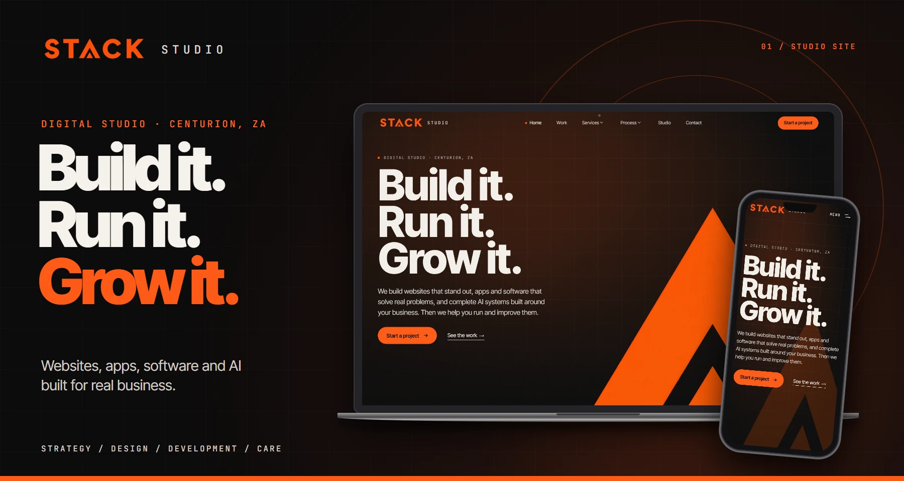
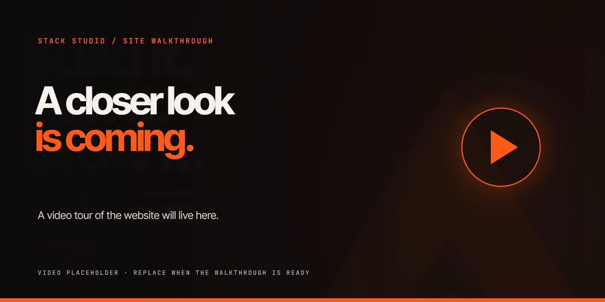
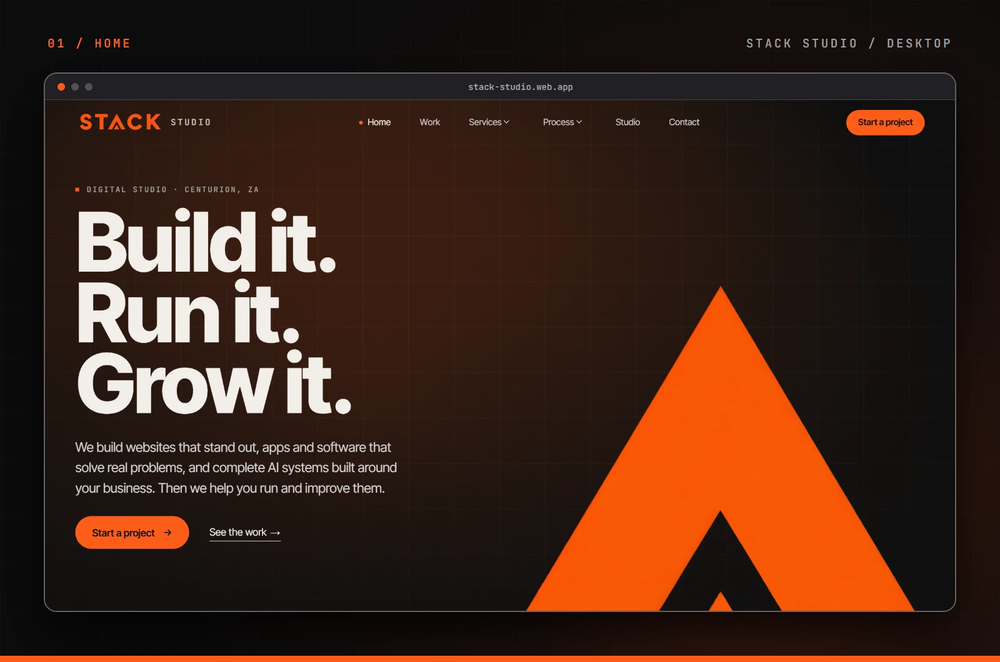
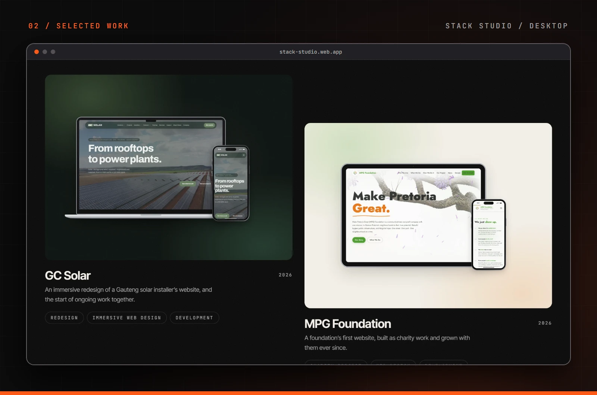
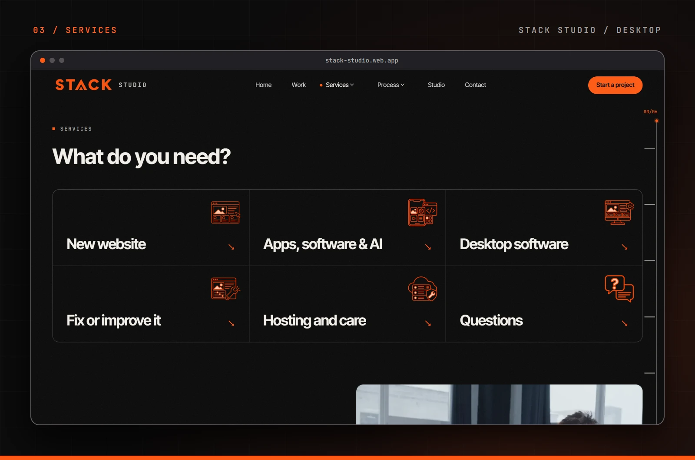
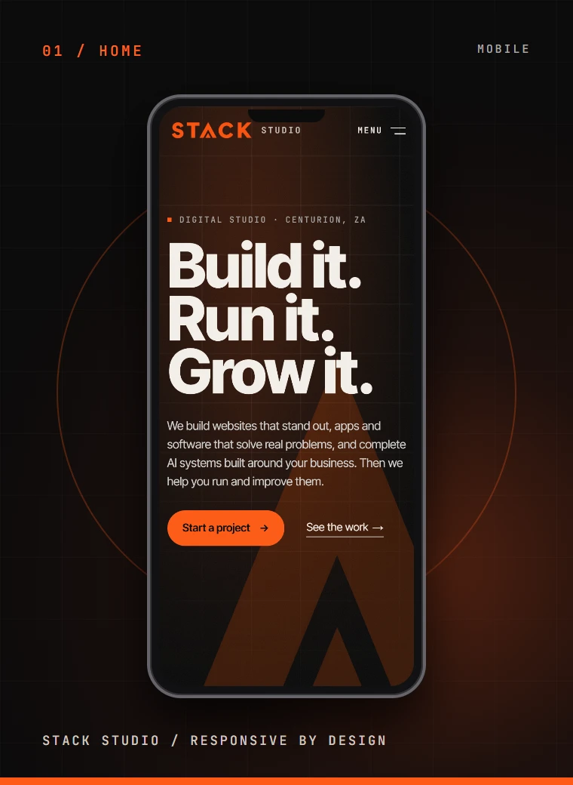
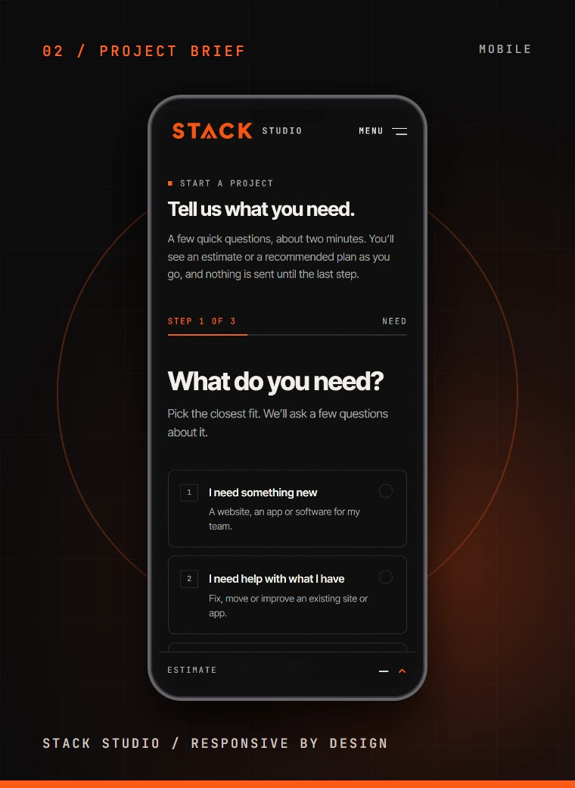

<a id="top"></a>

<div align="center">

  <a href="https://stack-studio.web.app/">
    
  </a>

  <h1>Stack Studio</h1>

  <p><strong>Build it. Run it. Grow it.</strong></p>

  <p>Websites, apps, software and AI systems for businesses ready to move forward.<br />Designed and built in Centurion, South Africa.</p>

  <p>
    <a href="https://stack-studio.web.app/"><strong>Explore the live site</strong></a>
    &nbsp;·&nbsp;
    <a href="https://stack-studio.web.app/work"><strong>See the work</strong></a>
    &nbsp;·&nbsp;
    <a href="https://stack-studio.web.app/start"><strong>Start a project</strong></a>
  </p>

  <p><code>React 19</code> · <code>TypeScript</code> · <code>Vite</code> · <code>Tailwind CSS v4</code> · <code>GSAP</code> · <code>Firebase</code></p>

</div>

---

## The website

Stack Studio is the studio's digital home: a responsive portfolio that introduces the team, explains its services and process, shows completed client work, and guides visitors into a project brief. Its visual language pairs bold type, warm orange, dark surfaces, detailed device imagery and purposeful motion.

The site follows a simple journey: **find → understand → trust → contact**. Each page gives visitors a clear next step without hiding the details they need to make a decision.

### What is inside

| Area                | What visitors can do                                                            |
| ------------------- | ------------------------------------------------------------------------------- |
| **Home**            | Get the studio's story, services, featured work and a clear route to the brief. |
| **Work**            | Explore case studies for GC Solar, MPG Foundation and Salon Friend.             |
| **Services**        | See websites, software, AI systems, hosting and ongoing care.                   |
| **Process**         | Understand the project timeline, collaboration and next steps.                  |
| **Studio**          | Meet the people and principles behind the work.                                 |
| **Start a project** | Complete a guided, validated brief with a tailored estimate.                    |
| **Contact**         | Send a general enquiry.                                                         |

The interface includes route transitions, scroll-led motion, responsive media and reduced-motion support. The project brief can use Firebase, EmailJS and an optional form endpoint; configuration and provider setup are documented below.

## Walkthrough

<div align="center">
  
  <p><em>A video tour will be added here when it is ready.</em></p>
</div>

<!-- When the walkthrough is ready, replace the image above with a linked video thumbnail or a GitHub-hosted video URL. -->

## Showcase

These mockups use screenshots captured from the running Stack Studio site. Open an image to see it at full size.

### Desktop

<a href="docs/readme/desktop-home.webp"></a>

<a href="docs/readme/desktop-work.webp"></a>

<a href="docs/readme/desktop-services.webp"></a>

### Mobile

<p align="center">
  <a href="docs/readme/mobile-home.webp"></a>
  <a href="docs/readme/mobile-brief.webp"></a>
</p>

## Selected work

| Project            | What we built                                                  | Case study                                                       |
| ------------------ | -------------------------------------------------------------- | ---------------------------------------------------------------- |
| **GC Solar**       | An immersive redesign for a Gauteng solar installer.           | [View project](https://stack-studio.web.app/work/gc-solar)       |
| **MPG Foundation** | The foundation's first website, with ongoing updates and care. | [View project](https://stack-studio.web.app/work/mpg-foundation) |
| **Salon Friend**   | A digital product for salon businesses.                        | [View project](https://stack-studio.web.app/work/salon-friend)   |

## Built with

| Layer                 | Tools                                               |
| --------------------- | --------------------------------------------------- |
| Interface             | React 19, TypeScript, Vite, Tailwind CSS v4         |
| Navigation and motion | React Router, GSAP, ScrollTrigger, SplitText, Lenis |
| Forms and validation  | zod, Firebase, EmailJS, optional JSON form endpoint |
| Quality               | ESLint, Prettier, `node:test`                       |
| Hosting               | Firebase Hosting                                    |

## Run locally

Use Node.js **24** (Vite also supports Node 20.19+ and 22.12+).

```bash
npm ci
cp .env.example .env.local
npm run dev
```

Open `http://localhost:5173`. The site can run without provider credentials, but live form delivery requires configuration. Copy only the values you use into `.env.local`:

| Variables            | Purpose                                                         |
| -------------------- | --------------------------------------------------------------- |
| `VITE_FIREBASE_*`    | Firebase web app, anonymous auth and Firestore enquiry storage. |
| `VITE_EMAILJS_*`     | Team notifications and client email replies.                    |
| `VITE_FORM_ENDPOINT` | Optional secondary JSON endpoint for project briefs.            |
| `VITE_ANALYTICS_ID`  | Optional Plausible-compatible analytics site ID.                |

The exact variable names and notes are in [`.env.example`](.env.example). All `VITE_*` values are exposed to the browser, so do not put private keys or server secrets there. See the [Firebase](docs/firebase-setup.md) and [EmailJS](docs/emailjs-setup.md) guides for form setup.

### Useful commands

| Command                 | Purpose                                                     |
| ----------------------- | ----------------------------------------------------------- |
| `npm run dev`           | Start the local development server.                         |
| `npm run build`         | Type-check and build the production site into `dist/`.      |
| `npm run preview`       | Preview the production build locally.                       |
| `npm run lint`          | Run ESLint.                                                 |
| `npm run typecheck`     | Run TypeScript checks.                                      |
| `npm test`              | Run the unit tests.                                         |
| `npm run format:check`  | Check formatting.                                           |
| `npm run readme:render` | Capture the local site and regenerate these README mockups. |

To update the README artwork after changing the site, start `npm run dev -- --host 127.0.0.1` in one terminal and run `npm run readme:render` in another. The generator needs local Chrome or Edge (or `CHROME_PATH`) and writes images to `docs/readme/`.

## Project map

```text
src/
  app/          App shell, providers and route table
  pages/        Home, Work, Services, Process, Studio, Start and other routes
  sections/     Page sections and shared content
  components/   UI, layout, media, motion and SEO components
  data/         Typed copy, projects, services, pricing and site settings
  lib/          Forms, analytics, motion, configuration and helpers
  styles/       Tokens, base styles and utilities
scripts/        Asset and mockup generators
docs/           Design, flow, provider setup and README artwork
public/         Static media, icons and hosting assets
tests/          Unit tests
```

The [design system](docs/design-system.md), [sitemap](docs/sitemap.md), [user flow](docs/user-flow.md) and [motion map](docs/motion-map.md) explain the site's structure and interaction rules. Contributors should also read [`CLAUDE.md`](CLAUDE.md).

## Deployment

The live site is hosted at **[stack-studio.web.app](https://stack-studio.web.app/)**. This repository's `.firebaserc` selects Firebase project `stack-studio-2f8a1`; `firebase.json` publishes `dist/` to Hosting site `stack-studio` and rewrites app routes to `index.html`.

```bash
npm run build
firebase deploy --only hosting
```

Use a Firebase CLI account with access to that project. If you change Firestore rules or indexes, follow the [Firebase setup guide](docs/firebase-setup.md) before deploying them.

---

<div align="center">
  <p><strong>Have something in mind?</strong> <a href="https://stack-studio.web.app/start">Let's build it.</a></p>
  <p><a href="#top">Back to top ↑</a></p>
</div>
